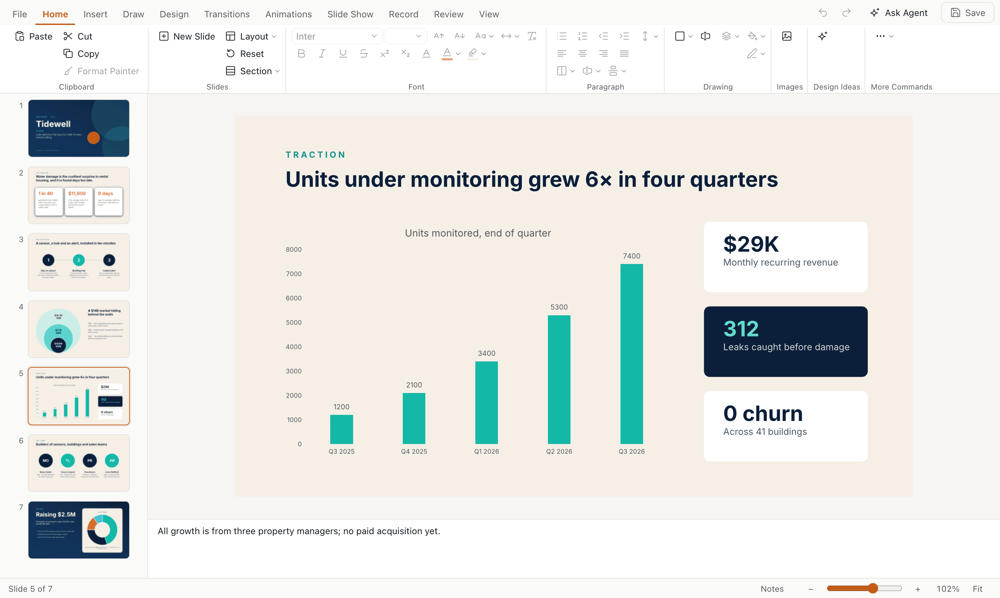
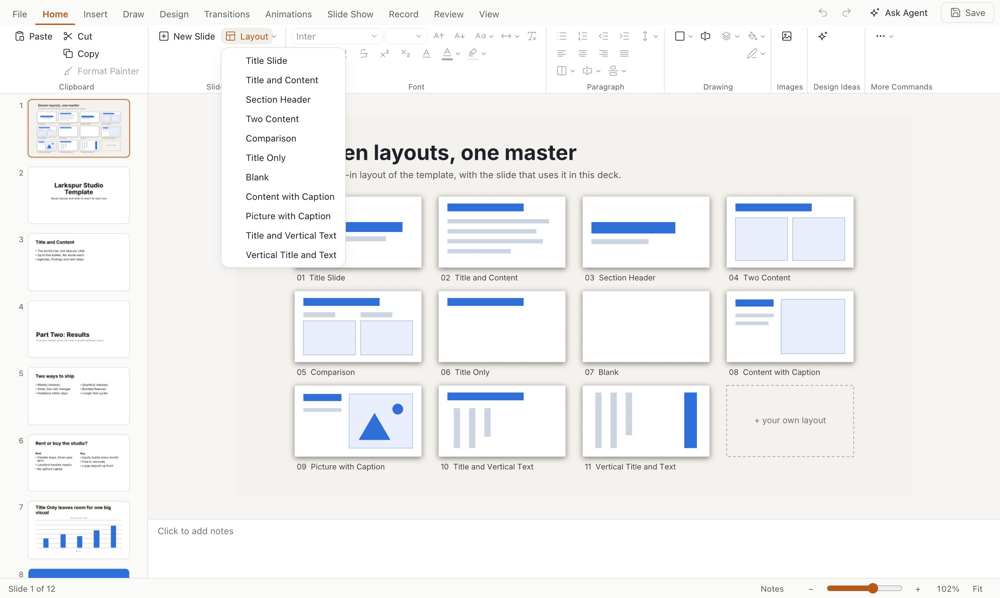
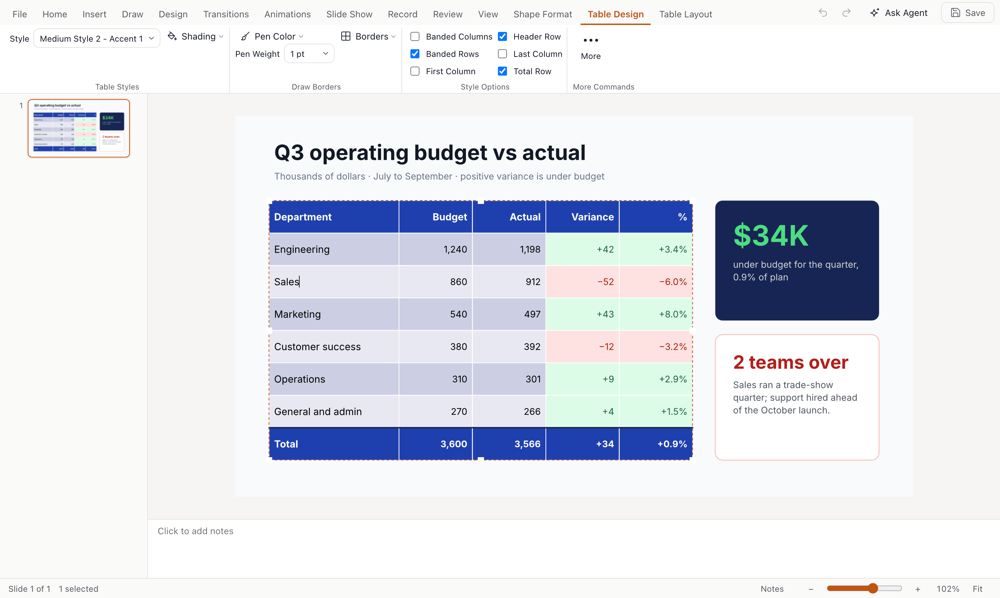
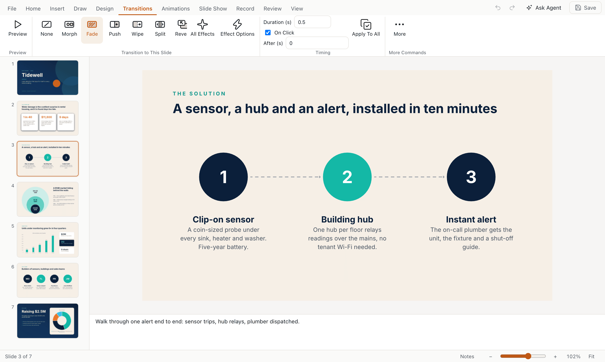
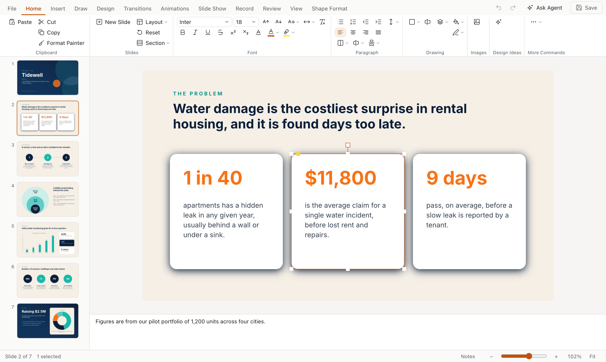
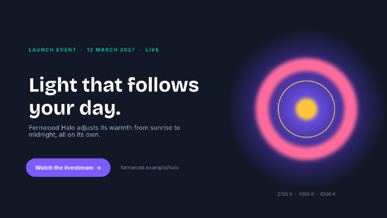
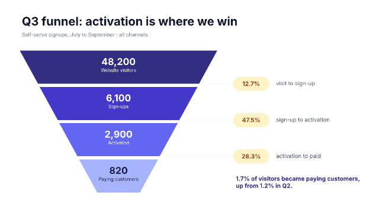
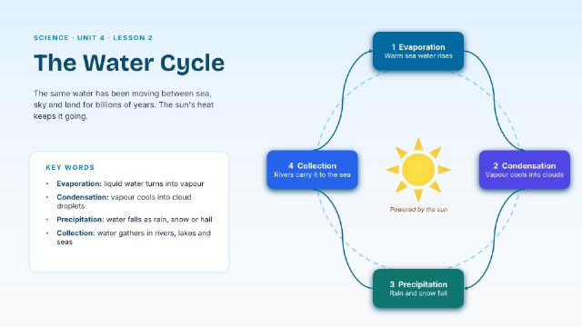
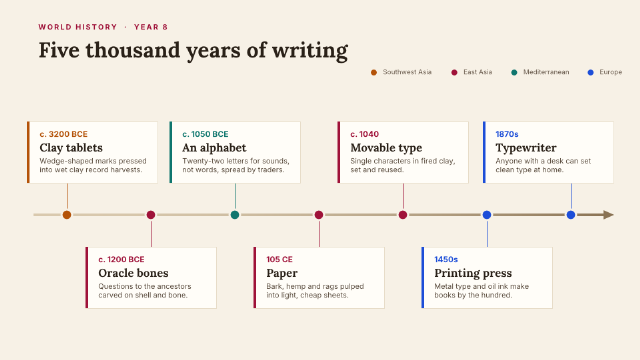

<div align="center">

# Kition Slide

**Kition Slide: a slide editor that opens .pptx files, for people and AI agents**

Layouts and speaker notes · Text and shapes · Tables · Transitions and animations · Opens .pptx · Agent tools with design hints

[](LICENSE)
[](https://www.npmjs.com/package/@kition/embed)
[](https://github.com/kitharness/khp)
[](bindings/wasm)

[Use it in Kition](https://kition.ai) · [Embed it](#embed-it-in-your-app) · [Give it to your agent](#give-it-to-your-agent) · [Showcase](https://github.com/KitionAI/kition-showcase/tree/main/slide) · [Developer docs](https://developer.kition.ai) · [KHP](https://github.com/kitharness/khp)

</div>

A deck travels. Someone sends you a `.pptx`, you change three slides, and you send it back. Many
tools that open it lose the layouts, the speaker notes or the transitions on the way. An AI agent
has it worse: it sees slides as XML, with no idea which box is the title.

Kition Slide is a slide editor built around the `.pptx` file and its own `.kslide`. You work with
a slides panel, a ribbon and speaker notes. An AI agent works on the same deck through tools that
run the same engine and the same commands. It reads each slide's shapes by id, edits them, and is
told what a designer would change.



## What it does

### Why Slide

- **Open the `.pptx` you were sent.** Slide edits `.pptx` files and its own `.kslide` and saves
  them back. Slides and layouts, text, shapes, tables, transitions and animations have round-trip
  tests through both formats.
- **Layouts do the arranging.** Start a slide from one of eleven layouts, or change the layout of
  the slide you are on. Duplicate, move, hide and rename slides.
- **Slides that look finished.** Fonts, bullets and numbering, columns and autofit in text; shapes
  you size, rotate, flip, fill and outline; tables with merged cells, borders, shading and styles.
- **Notes and motion, kept in the file.** Write speaker notes under every slide. Set transitions
  and animations with their timing, and they are saved with the deck.
- **An agent works on the same deck.** It names the slide and shapes it acts on, so your current
  slide and selection stay where they are. It is told what a designer would change, with the
  commands that change it, and fixes what the check reports. Its edits can go to a draft that you
  review and merge.
- **Open source, in Rust.** Apache-2.0, engine and editor. The engine is compiled to WebAssembly
  and runs in a Web Worker, off your page's main thread.

### See it

<table>
<tr>
<td width="50%"><br /><b>Layouts</b>: eleven built-in layouts; give the slide you are on another one from the Layout menu.</td>
<td width="50%"><br /><b>Tables</b>: a style, banded rows, a header and a total row, shading and borders, from the Table Design tab.</td>
</tr>
<tr>
<td width="50%"><br /><b>Transitions</b>: choose one for each slide, with its duration; it is saved with the deck.</td>
<td width="50%"><br /><b>Shapes</b>: select one to move, resize, rotate or reshape it with its handles.</td>
</tr>
</table>

### Made with Slide

<table>
<tr>
<td width="25%"><a href="https://github.com/KitionAI/kition-showcase/tree/main/slide/product-launch-keynote"></a></td>
<td width="25%"><a href="https://github.com/KitionAI/kition-showcase/tree/main/slide/sales-funnel-stages"></a></td>
<td width="25%"><a href="https://github.com/KitionAI/kition-showcase/tree/main/slide/water-cycle-lesson"></a></td>
<td width="25%"><a href="https://github.com/KitionAI/kition-showcase/tree/main/slide/history-of-writing-timeline"></a></td>
</tr>
</table>

Every sample is built with Slide's own commands. [See all of them](https://github.com/KitionAI/kition-showcase/tree/main/slide).

### Formats

| Opens | Creates | Exports |
| --- | --- | --- |
| `.kslide`, `.pptx` (edits and saves both) | `.kslide` | `.pdf`, `.png`, `.jpg` |

## Quick start

### Use it in Kition

In Kition, a `.pptx` or `.kslide` file opens in this editor. Kition's agent edits the same deck
with the kit's `slide_*` tools. [Download Kition](https://github.com/KitionAI/kition/releases/latest).

### Embed it in your app

Slide's editor is a static package you host yourself, mounted into your page with
[`@kition/embed`](https://www.npmjs.com/package/@kition/embed). You keep the files and the users;
the editor reads and writes through the functions you give it.

1. Download `kition-slide-<version>.tgz` from the
   [latest release](https://github.com/KitionAI/kition-slide/releases/latest) and serve its
   `slide-ui/` folder as static files on its own origin, with the headers in the
   [embed reference](https://github.com/KitionAI/kition-sdk/blob/main/docs/platform/reference/embed.md).
2. Install the SDK and mount the editor:

```sh
npm install @kition/embed
```

```ts
import { KitionEmbed } from '@kition/embed'

const editor = await KitionEmbed.mount(document.getElementById('slides')!, {
  kit: { id: 'kit.slide', url: 'https://kits.example.com/slide-ui/' }, // the package you host
  file: { id: 'seed-deck', name: 'Seed deck.pptx' },
  storage: {
    read: async (id) => api.read(id),                    // { bytes, version }
    write: async (id, bytes, { expectedVersion }) =>     // refuse a stale version
      api.write(id, bytes, expectedVersion),             // { version }
  },
})
```

Every save carries the version it read, so an edit made elsewhere is never written over. Identity
and permissions, co-editing, and an agent's draft reviewed in your page are in the
[embed guide](https://github.com/KitionAI/kition-sdk/blob/main/docs/sdk/embed.md).

### Give it to your agent

The engine also runs headless as the `kition-slide` program, and the SDK's `kition-kits-mcp` turns
it into MCP tools (`slide_inspect`, `slide_run`, `slide_check`, …) on a folder of presentations,
for any MCP client:

```sh
cargo build --release -p kition-slide
cargo install --git https://github.com/KitionAI/kition-sdk kition-kits --bin kition-kits-mcp
kition-kits-mcp --workspace <folder of presentations> --kit target/release/kition-slide
```

A real session on a copy of the showcase's seed pitch deck, abridged:

```text
> slide_inspect {"path":"pitch.pptx","target":{"slide":7}}
Opened `pitch.pptx`: 7 slides, 960 × 540 pt
{…,"part":{…,"design":[{"code":"design.small-text",
  "message":"\"TextBox 1\" has text under 15 pt, hard to read when presented. Keep body text at 18 pt or more.",
  "shapes":[322],"try":["format.size {ids, size}"]}],…,"layout":"Blank",
  "notes":"Close on the milestone: 40,000 units makes the Series A story.",
  "shapes":[…,{"id":322,"kind":"textBox","name":"TextBox 1","text":"THE ASK",…},
    {"id":323,"kind":"textBox","name":"TextBox 2","text":"Raising $2.5M",…}, …]},"revision":"vif0",…}

> slide_run {"path":"pitch.pptx","basis":"vif0","steps":[
    {"command":"text.set","at":{"part":{"slide":7}},"params":{"id":323,"text":"Raising $3M"}},
    {"command":"format.size","params":{"ids":[322],"onSlide":7,"size":18}}]}
Ran 2 commands on `pitch.pptx` (saved): 7 slides, 960 × 540 pt Changes: objects 2 changed.

> slide_check {"path":"pitch.pptx"}
Checked `pitch.pptx`: the kit found nothing wrong.
{"diagnostics":[]}

> slide_inspect {"path":"pitch.pptx","target":{"slide":7}}
{…,"part":{…,"design":[],…,"shapes":[…,{"id":323,…,"text":"Raising $3M",…}, …]},"revision":"vif1",…}
```

The agent changed the amount on the closing slide, kept its font and size, and took the design
hint on the small kicker; the second inspect has no hints left. The agent's guide is
[agent/guide.md](agent/guide.md).

## Maturity

Version 0.1.0 · KHP 1.0, conformance level `basic`.

| Works today | Partly there | Not yet |
| --- | --- | --- |
| Slides, layouts and speaker notes<br />Text and its formatting: fonts, bullets, numbering, columns, autofit<br />Shapes: size, rotate, flip, fill, outline, effects<br />Tables: rows, columns, merging, borders, shading, styles<br />Setting transitions and animations; agent tools with drafts | Themes and slide masters<br />Charts, pictures, audio and video<br />Comments<br />The slide show and the presenter view<br />Export to PDF, PNG and JPEG | Playing transitions, animations and media in the slide show<br />Pasting pictures from the system clipboard<br />Printing<br />Legacy `.ppt` files and OpenDocument `.odp`<br />Exporting video or animated GIFs |

Known gaps: [docs/gaps.md](docs/gaps.md). What's next: [docs/roadmap.md](docs/roadmap.md).

## Build and contribute

Build and test instructions are in [docs/development.md](docs/development.md). Read
[CONTRIBUTING.md](.github/CONTRIBUTING.md) before opening a pull request, and ask questions in
[Discussions](https://github.com/KitionAI/kition/discussions) or on [Discord](https://discord.gg/bFSjRDjVY).

## License

Apache-2.0 ([LICENSE](LICENSE)). Third-party licenses and notices are listed in [NOTICE](NOTICE)
and [docs/attribution.md](docs/attribution.md).

Portions of this kit are derived from a project dual-licensed under MIT or Apache-2.0, used here
under the MIT License and credited in [NOTICE](NOTICE).
